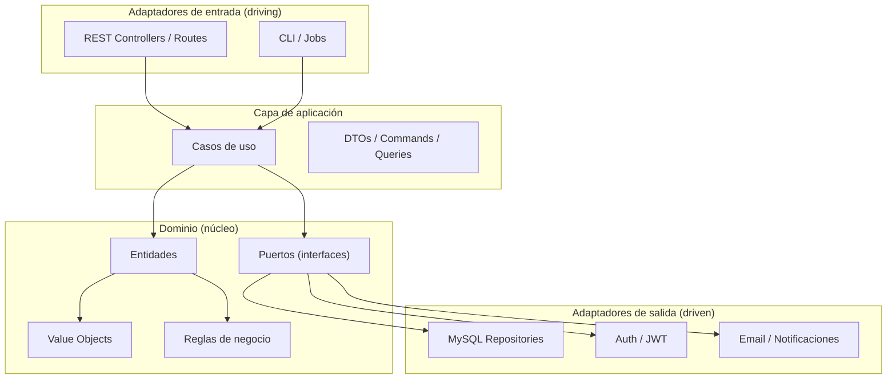
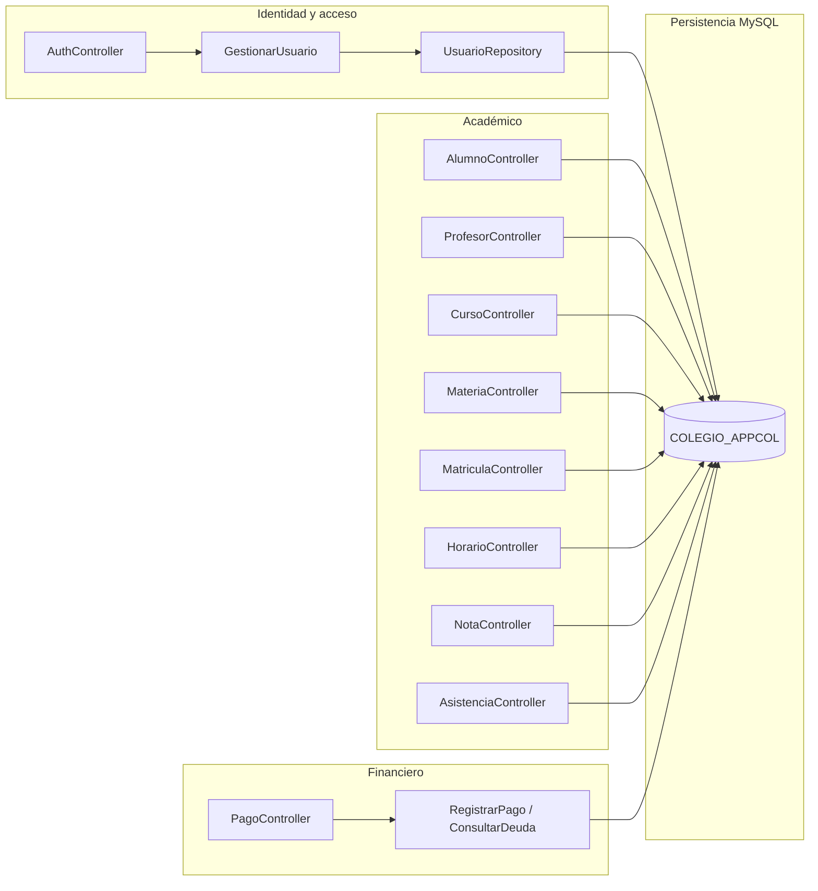
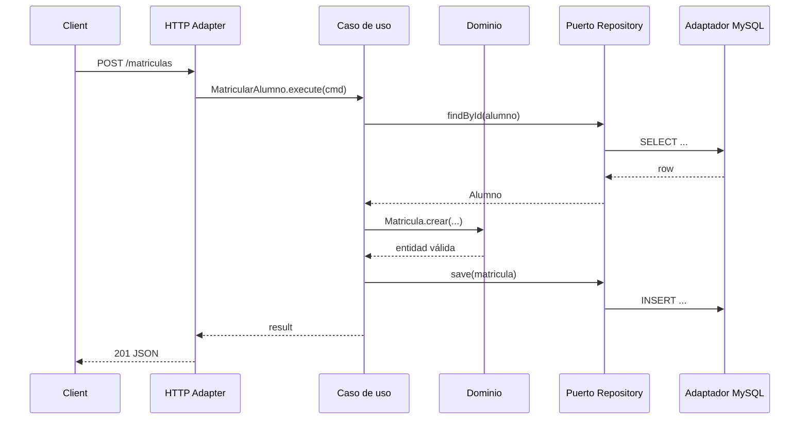

# Arquitectura hexagonal — API Colegio AppCol

Propuesta de backend basada en el modelo `COLEGIO_APPCOL`. Aún **no hay código de API** en el repositorio; este documento define la estructura recomendada.

## Principio

El **dominio** no depende de frameworks, HTTP ni MySQL. Los adaptadores (REST, persistencia, autenticación) implementan puertos definidos por el núcleo.



---

## Diagrama de componentes por bounded context



---

## Estructura de carpetas sugerida

```text
backend/
├── src/
│   ├── domain/
│   │   ├── alumnos/
│   │   │   ├── Alumno.ts
│   │   │   └── ports/AlumnoRepository.ts
│   │   ├── profesores/
│   │   ├── cursos/
│   │   ├── materias/
│   │   ├── matriculas/
│   │   ├── horarios/
│   │   ├── notas/
│   │   ├── asistencia/
│   │   ├── pagos/
│   │   └── usuarios/
│   ├── application/
│   │   ├── alumnos/
│   │   │   ├── CrearAlumno.ts
│   │   │   ├── ActualizarAlumno.ts
│   │   │   └── ListarAlumnos.ts
│   │   ├── matriculas/
│   │   ├── asistencia/
│   │   ├── notas/
│   │   ├── pagos/
│   │   └── auth/
│   ├── infrastructure/
│   │   ├── persistence/mysql/
│   │   │   ├── AlumnoMysqlRepository.ts
│   │   │   ├── ...
│   │   │   └── connection.ts
│   │   ├── auth/JwtService.ts
│   │   └── config/
│   └── adapters/
│       └── http/
│           ├── routes/
│           ├── controllers/
│           ├── middlewares/
│           └── dto/
├── tests/
└── package.json   # o pom.xml / go.mod según stack
```

Stack sugerido (cualquiera vale si respeta hexágono):

- **Node.js + NestJS / Express + TypeScript**
- **Java + Spring Boot**
- **.NET + Clean Architecture**

---

## Mapa dominio ↔ tablas

| Módulo de dominio | Tabla(s) | Casos de uso principales |
|-------------------|----------|--------------------------|
| Alumno | Alumnos | CRUD, búsqueda por grado |
| Profesor | Profesores | CRUD, listar por especialidad |
| Curso | Curso | CRUD, capacidad |
| Materia | Materia | CRUD, asignar profesor |
| Matricula | Matriculas | matricular, retirar, listar por año |
| Horario | Horarios | crear jornada, consultar por grado/día |
| Nota | Notas | registrar, consultar boleta *(requiere enriquecer modelo)* |
| Asistencia | Asistencia | marcar, reporte por materia/fecha |
| Pago | Pagos | emitir, registrar pago, deuda |
| Usuario / Auth | Usuarios | login, roles, hash de contraseña |

---

## Puertos (ejemplos)

```typescript
// domain/alumnos/ports/AlumnoRepository.ts
export interface AlumnoRepository {
  findById(id: number): Promise<Alumno | null>;
  findAll(filters?: { grado?: string }): Promise<Alumno[]>;
  save(alumno: Alumno): Promise<Alumno>;
  delete(id: number): Promise<void>;
}
```

```typescript
// application/matriculas/MatricularAlumno.ts
export class MatricularAlumno {
  constructor(
    private alumnos: AlumnoRepository,
    private cursos: CursoRepository,
    private matriculas: MatriculaRepository,
  ) {}

  async execute(cmd: { alumnoId: number; cursoId: number; anio: number }) {
    const alumno = await this.alumnos.findById(cmd.alumnoId);
    if (!alumno) throw new NotFoundError("Alumno");
    const curso = await this.cursos.findById(cmd.cursoId);
    if (!curso) throw new NotFoundError("Curso");
    if (!curso.tieneCupo()) throw new DomainError("Curso sin capacidad");
    return this.matriculas.save(
      Matricula.crear(alumno, curso, cmd.anio),
    );
  }
}
```

---

## API REST propuesta

Base: `/api/v1` · Auth: Bearer JWT · Roles: `admin`, `profesor`, `alumno`, `acudiente`

| Método | Ruta | Descripción |
|--------|------|-------------|
| POST | `/auth/login` | Autenticación |
| POST | `/auth/register` | Alta de usuario (admin) |
| GET/POST | `/alumnos` | Listar / crear |
| GET/PUT/DELETE | `/alumnos/:id` | Detalle / actualizar / eliminar |
| GET/POST | `/profesores` | Listar / crear |
| GET/PUT/DELETE | `/profesores/:id` | CRUD |
| GET/POST | `/cursos` | Listar / crear |
| GET/POST | `/materias` | Listar / crear |
| GET/POST | `/matriculas` | Listar / matricular |
| PATCH | `/matriculas/:id/estado` | Activar / retirar |
| GET/POST | `/horarios` | Consultar / crear |
| GET/POST | `/notas` | Consultar / registrar |
| GET/POST | `/asistencias` | Consultar / marcar |
| GET/POST | `/pagos` | Listar / emitir |
| PATCH | `/pagos/:id/pagar` | Registrar cobro |

### Ejemplo de contrato

```http
POST /api/v1/matriculas
Authorization: Bearer <token>
Content-Type: application/json

{
  "idEstudiante": 12,
  "idGrado": 3,
  "anio": 2026
}
```

```json
{
  "id": 101,
  "idEstudiante": 12,
  "idGrado": 3,
  "anio": 2026,
  "estado": "activa"
}
```

---

## Flujo de un request (hexágono)



---

## Dependencias permitidas

| Capa | Puede depender de |
|------|-------------------|
| Dominio | nada externo |
| Aplicación | dominio |
| Infraestructura | dominio (implementa puertos) |
| Adaptadores HTTP | aplicación + DTOs |

Regla de oro: **nunca** importar MySQL/Express desde `domain/`.

---

## Mejoras de modelo antes de implementar API

1. Corregir FK invertidas y declarar las FK lógicas faltantes.
2. Completar `Notas` (materia, periodo, valor, observaciones).
3. Eliminar columnas duplicadas y tipografía `NONBRE`.
4. Unificar tipos (`ID_Estudiante` siempre `int`).
5. Hash de `Contraseña` (bcrypt/argon2) en adaptador de auth.
6. Evitar copiar `Nombre_Estudiante` en Matriculas/Pagos (resolver por JOIN).
