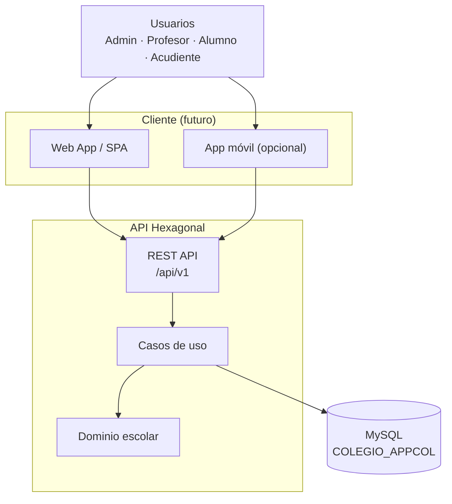
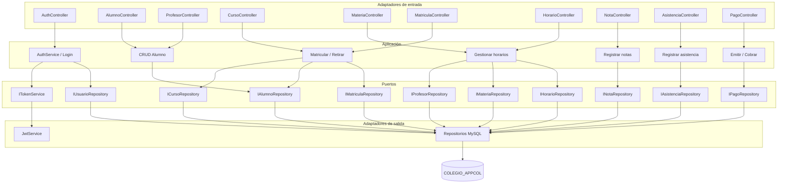
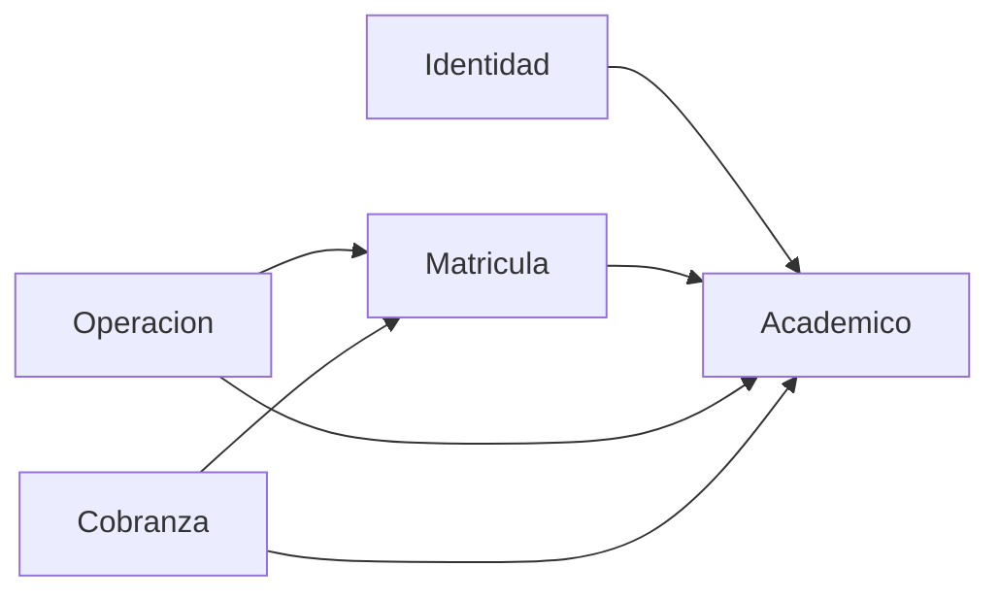

# Diagrama de componentes del sistema

Vista lógica de **Colegio AppCol** a partir del modelo en `recursos/` y la API propuesta.

## Vista C4 — contenedores

## Componentes de la API

## Módulos de negocio y responsabilidades

| Componente | Responsabilidad | Tablas |
|------------|-----------------|--------|
| Identidad | Login, roles, sesión | Usuarios |
| Gestión académica | Alumnos, profesores, cursos, materias | Alumnos, Profesores, Curso, Materia |
| Matrícula | Inscripción anual a grado | Matriculas |
| Operación diaria | Horarios, asistencia, notas | Horarios, Asistencia, Notas |
| Cobranza | Pensiones y conceptos de pago | Pagos |

## Dependencias entre módulos

Regla: **Académico** es el núcleo compartido; Identidad, Matrícula, Operación y Cobranza dependen de él, no al revés.
