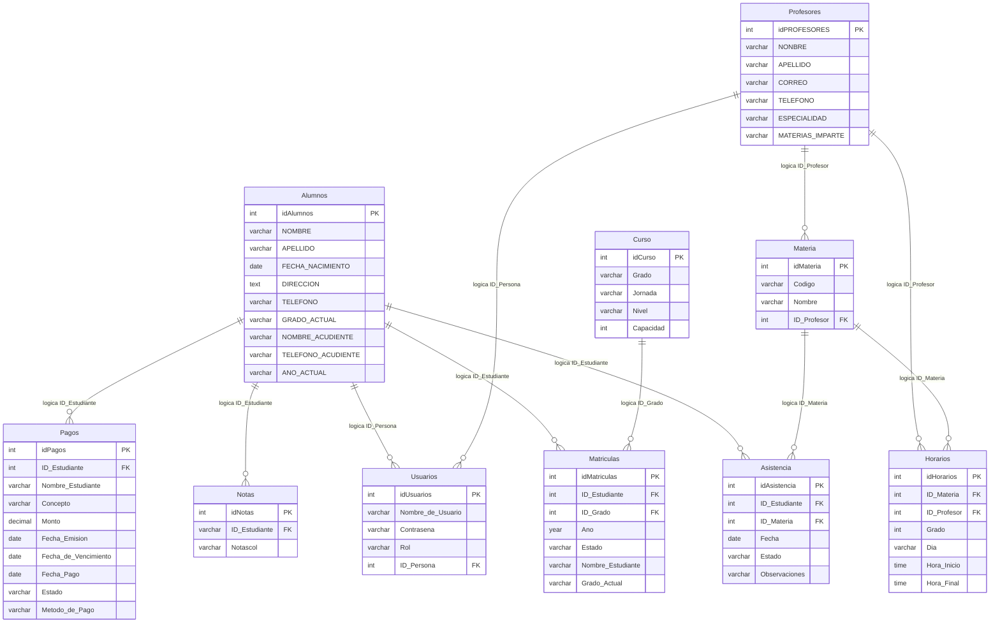

# Modelo de datos — COLEGIO_APPCOL

Fuente: `recursos/App_colle.mwb` (MySQL Workbench, esquema `COLEGIO_APPCOL`).

## Resumen

Aplicación de gestión escolar con **10 tablas** (más un schema vacío `mydb` y una vista stub `view1`).

| Dominio | Tablas |
|---------|--------|
| Personas | `Alumnos`, `Profesores`, `Usuarios` |
| Académico | `Curso`, `Materia`, `Matriculas`, `Horarios`, `Notas`, `Asistencia` |
| Financiero | `Pagos` |

---

## Diagrama entidad-relación (estado actual del MWB)

Solo existen **2 FK declaradas** en el modelo, y ambas están **invertidas** (ver sección de hallazgos).



---

## Catálogo de tablas

### Alumnos
| Columna | Tipo | Notas |
|---------|------|-------|
| idAlumnos | int | PK |
| NOMBRE | varchar(50) | |
| APELLIDO | varchar | **duplicada** (aparece 2 veces en el MWB) |
| FECHA_NACIMIENTO | date | |
| DIRECCION | text | |
| TELEFONO | varchar | |
| GRADO_ACTUAL | varchar | denormalizado vs `Curso` / `Matriculas` |
| NOMBRE_ACUDIENTE | varchar | |
| TELEFONO_ACUDIENTE | varchar | |
| AÑO_ACTUAL | varchar | |

### Profesores
| Columna | Tipo | Notas |
|---------|------|-------|
| idPROFESORES | int | PK, NN |
| NONBRE | varchar | tipografía: debería ser `NOMBRE` |
| APELLIDO | varchar | |
| CORREO | varchar | |
| TELEFONO | varchar | |
| ESPECIALIDAD | varchar | |
| MATERIAS_IMPARTE | varchar | mejor modelar vía `Materia` |

### Materia
| Columna | Tipo | Notas |
|---------|------|-------|
| idMateria | int | PK |
| Codigo | varchar | |
| Nombre | varchar | |
| ID_Profesor | int | FK lógica → `Profesores` |

### Curso
| Columna | Tipo | Notas |
|---------|------|-------|
| idCurso | int | PK, NN |
| Grado | varchar | |
| Jornada | varchar | |
| Nivel | varchar | |
| Capacidad | int | |

### Matriculas
| Columna | Tipo | Notas |
|---------|------|-------|
| idMatriculas | int | PK, NN |
| ID_Estudiante | int | FK lógica → `Alumnos` |
| ID_Grado | int | FK lógica → `Curso` |
| Año | year | |
| Estado | varchar | ej. activa / retirada |
| Nombre_Estudiante | varchar | redundante |
| Grado_Actual | varchar | redundante |

### Horarios
| Columna | Tipo | Notas |
|---------|------|-------|
| idHorarios | int | PK, NN |
| ID_Materia | int | FK lógica → `Materia` |
| ID_Profesor | int | FK lógica → `Profesores` |
| Grado | int | debería referir `Curso` |
| Dia | varchar | |
| Hora_Inicio | time | |
| Hora_Final | time | |

### Notas
| Columna | Tipo | Notas |
|---------|------|-------|
| idNotas | int | PK, NN |
| ID_Estudiante | varchar | tipo inconsistente (debería ser `int`) |
| Notascol | varchar | columna incompleta / placeholder |

### Pagos
| Columna | Tipo | Notas |
|---------|------|-------|
| idPagos | int | PK, NN |
| ID_Estudiante | int | FK lógica → `Alumnos` |
| Nombre_Estudiante | varchar | redundante |
| Concepto | varchar | |
| Monto | decimal | |
| Fecha_Emision | date | |
| Fecha_de_Vencimiento | date | |
| Fecha_Pago | date | |
| Estado | varchar | |
| Metodo_de_Pago | varchar | **duplicada** en el MWB |

### Usuarios
| Columna | Tipo | Notas |
|---------|------|-------|
| idUsuarios | int | PK, NN |
| Nombre_de_Usuario | varchar | |
| Contraseña | varchar | no almacenar en texto plano |
| Rol | varchar | alumno / profesor / admin |
| ID_Persona | int | polimórfico (alumno o profesor) |

### Asistencia
| Columna | Tipo | Notas |
|---------|------|-------|
| idAsistencia | int | PK, NN |
| ID_Estudiante | int | FK lógica → `Alumnos` |
| ID_Materia | int | FK lógica → `Materia` |
| Fecha | date | |
| Estado | varchar | presente / ausente / tarde |
| Observaciones | varchar | |

---

## FK declaradas en el MWB (tal cual)

| Nombre | Tabla origen | Columna | Referencia | Problema |
|--------|--------------|---------|------------|----------|
| `fk_id_estudiante` | Alumnos | idAlumnos | Asistencia.idAsistencia | Dirección invertida |
| `fk_id_Materia` | Materia | idMateria | Asistencia.idAsistencia | Dirección invertida |

### FK recomendadas

```text
Asistencia.ID_Estudiante  → Alumnos.idAlumnos
Asistencia.ID_Materia     → Materia.idMateria
Materia.ID_Profesor       → Profesores.idPROFESORES
Matriculas.ID_Estudiante  → Alumnos.idAlumnos
Matriculas.ID_Grado       → Curso.idCurso
Horarios.ID_Materia       → Materia.idMateria
Horarios.ID_Profesor      → Profesores.idPROFESORES
Notas.ID_Estudiante       → Alumnos.idAlumnos
Pagos.ID_Estudiante       → Alumnos.idAlumnos
```

---

## Hallazgos de calidad del modelo

1. **FK invertidas** entre Alumnos/Materia y Asistencia.
2. **Columnas duplicadas**: `APELLIDO` (Alumnos), `Metodo_de_Pago` (Pagos).
3. **Typo**: `NONBRE` → `NOMBRE` en Profesores.
4. **Tabla Notas incompleta**: falta materia, periodo, valor numérico; `Notascol` parece placeholder.
5. **Falta de integridad referencial** en la mayoría de relaciones lógicas.
6. **Datos denormalizados**: nombres/grados repetidos en Matriculas y Pagos.
7. **Usuarios.ID_Persona** polimórfico sin discriminador claro (solo `Rol`).
8. **Contraseñas** sin política de hash en el modelo.
9. Convención de nombres inconsistente (`idAlumnos` vs `idPROFESORES` vs `ID_Estudiante`).
